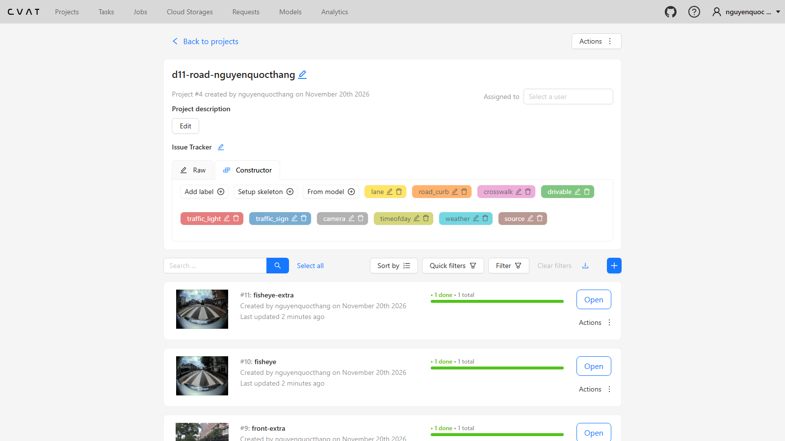
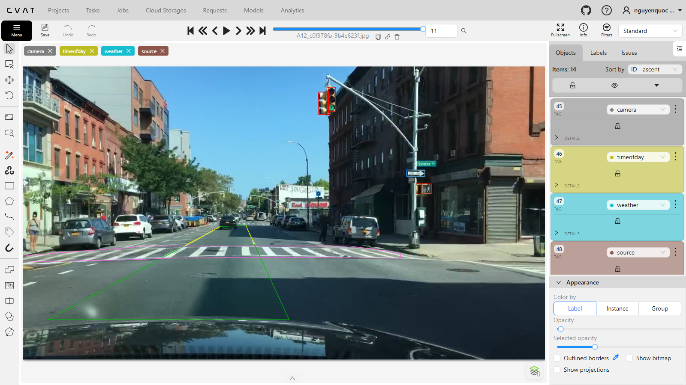
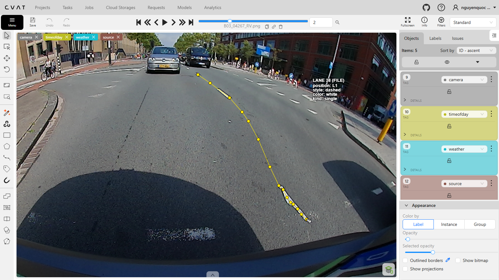
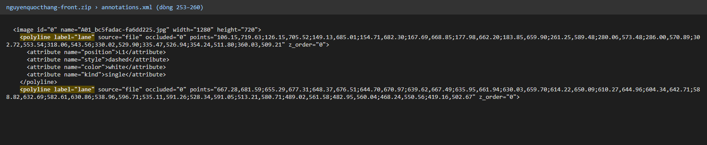

# Báo cáo cá nhân — Ngày 11
Họ tên: Nguyễn Quốc Thắng               Mã học viên: 2A202603158  
Phiên bản CVAT (Help → About): 2.82.0 (CVAT chạy trên máy cá nhân bằng Docker, http://localhost:8080; project `d11-road-nguyenquocthang`)  
Guideline: Road v1.0    Lần nộp (`revision` trong manifest): 1  
Thời điểm export (ngày giờ trên CVAT): 20/11/2026 22:15    Số lần nộp lại sau Rework: 0  

## 1. Kiểm project
| Mục | Đúng như guideline Road v1.0? | Ghi chú |
| --- | --- | --- |
| 6 label, đúng kiểu | Đúng | lane, road_curb: polyline · crosswalk, drivable: polygon · traffic_light, traffic_sign: rectangle. Đối chiếu Raw labels với `python -m road_lab.taxonomy` |
| Thuộc tính và giá trị | Đúng | lane: position/style/color/kind · drivable: area_type · đèn: color/type/facing/edge_zone · biển: group/facing/edge_zone. Giá trị mặc định là phần tử đầu danh sách (lane mới mang `L1/solid/white/single`), nên mọi thuộc tính đều được sửa và kiểm lại sau khi vẽ |
| 4 tag ảnh | Đúng | camera, timeofday, weather, source; mỗi label kiểu Tag có một thuộc tính select `value` |

Cách kết thúc polyline trên bản CVAT này: click lần lượt các điểm từ gần xe ra xa, xong thì bấm phím **N**.  
Cách đặt tag ảnh trên bản CVAT này: chọn công cụ **Tag** ở thanh bên trái, chọn label, bấm Tag. Sau đó mở **Details** của tag trong bảng Objects để chọn `value`. Đặt camera trước tiên.

## 2. Số lượng đã gán
| Task | Ảnh | lane | road_curb | crosswalk | drivable | traffic_light | traffic_sign |
| --- | ---: | ---: | ---: | ---: | ---: | ---: | ---: |
| front | 12 | 25 | 4 | 3 | 5 | 17 | 14 |
| front-extra (đã làm 4 / 4) | 4 | 11 | 0 | 1 | 2 | 10 | 0 |
| fisheye | 8 | 3 | 2 | 6 | 3 | 3 | 1 |
| fisheye-extra (đã làm 3 / 4) | 4 | 1 | 0 | 3 | 1 | 0 | 0 |

- Cả 28 ảnh đều đủ bốn tag (manifest: `images_all_tags` = 16 / 16 và 12 / 12).
- Mỗi ảnh chỉ gán nhóm label trong kế hoạch ảnh (guideline mục 2). Lane và road_curb gán ở mọi ảnh front; các nhóm khác theo trọng tâm từng slot. Ví dụ: A07–A08 có đèn, A09–A10 có biển, A04–A05 có vùng lái, A06 có crosswalk, A11–A12 có đủ loại. Ảnh fisheye theo cột trọng tâm của `manifests/manifest_fisheye.csv`.
- B09 chỉ có tag, không có hình. Kế hoạch của B09 là "đèn/biển sát mép + lane", nhưng trong ảnh chỉ có vạch ngựa vạn và biển quảng cáo của cửa hàng (không phải biển giao thông), không có vạch làn dọc hay đèn/biển ≥ 8 px. Guideline không cho gán nhóm label ngoài kế hoạch, nên ảnh thêm này không gán hình nào.

## 3. Bảng ca khó
| Ảnh | Nhãn | Phân vân giữa | Đã chọn | Lý do |
| --- | --- | --- | --- | --- |
| A01–A16 | nhóm label mỗi ảnh | gán mọi thứ thấy được hay chỉ nhóm trong kế hoạch | chỉ nhóm trong kế hoạch | Guideline mục 2: "không gán những loại không được yêu cầu cho ảnh đó". Bảng kế hoạch (slide Task 1) không có trong repo nên lấy cột trọng tâm của bảng SLOTS (`select_bdd_road.py`). Lane + road_curb giữ ở mọi ảnh vì rubric yêu cầu đủ L1/R1 trên mọi ảnh thấy được |
| A03 | lane R1, occluded | bật hay tắt occluded | bật | Slot "làn bị che". Vạch đứt R1 đi xuyên qua chữ SCHOOL sơn trên mặt đường; đoạn gần xe không thấy vệt sơn nên chỉ vẽ đoạn thấy được |
| A03 | lane L1 | vạch vàng trong hay vạch vàng ngoài | vạch vàng trong (sát làn mình) | Vạch ngoài là viền dải phân cách có gạch chéo. Đo vị trí sơn theo từng hàng pixel để đặt điểm trên tâm vạch trong |
| A04, A11, A14 | lane L1 vàng đôi | một polyline ở giữa hay trên một nét | một polyline ở giữa hai nét, `kind = double` | Guideline: một vạch là một polyline; vạch đôi ghi bằng `kind`. Tâm lấy bằng trung bình tâm hai nét trên từng hàng |
| A05 | lane L1/R1 | vẽ hay không | không vẽ | Đường không kẻ vạch. Lint báo QC1-02; cần coach xác nhận để miễn |
| A05 | drivable direct | gồm hay bỏ dải đỗ xe | bỏ | Guideline loại dải đỗ sát lề khỏi direct; biên dải đỗ là ước lượng vì không có vạch |
| A06, A08, A09 | lane R1 / L1 / R1 | vẽ hay không | không vẽ | Phía đó không có vệt sơn (A06: hàng cột; A08: vùng rộng không vạch; A09: mép đường không sơn → road_curb). Cần coach xác nhận để miễn QC1-02 |
| A07 | "L1" sát dải phân cách | lane hay road_curb | road_curb | Dải sáng chỉ rộng 2–8 px ở chân dải phân cách bê tông, không phải vệt sơn. Lane thừa là lỗi nặng QC1-03 |
| A07, A13 | tag weather | rain hay overcast | rain | Mặt đường ướt rõ / kính có giọt mưa: đúng định nghĩa `rain` |
| A09 | vạch trắng cong bên trái | lane L2 hay road_curb | road_curb | Đó là mép đảo giao thông sơn trắng (vỉa), không phải vạch kẻ trên mặt đường |
| A09, A12 | chọn làn đang đi | vạch nào là L1/R1 | A09: vạch đứt là L1; A12: vạch liền trái là L1, vạch đứt là R1 | Ngoại suy các vạch xuống đáy ảnh và so với tâm camera (x≈640). Nhầm làn là lỗi nặng nên ghi lại |
| A10 | lane R1 | nối qua chỗ che hay dừng | dừng ở (945,517) | Phản chiếu trên kính và xe SUV che quá dài, không phải "đoạn che ngắn" |
| A10 | biển phụ | supplementary hay information | supplementary | Tấm trắng nhỏ ngay dưới biển chính đỏ, ghi điều kiện đi kèm biển chính |
| A08, A12 | đèn đi bộ | màu nào | hình người đi → green; bàn tay cam → red | Bộ giá trị không có walk/don't walk; chọn theo ý nghĩa cho phép / cấm |
| A07, A08, A14, A16 | hộp đèn ở xa / ban đêm | kích thước hộp | ước lượng theo tỉ lệ đèn 3 bóng | Vỏ đèn chìm trong nền tối hoặc quầng sáng; chỉ thấy rõ bóng đang sáng |
| A09 | mặt sau biển | group | other, facing back | Không thấy mặt biển nên không xếp được nhóm theo chức năng |
| A16 | crosswalk xa, đèn đi bộ cam | gán hay bỏ | bỏ | Dải ngựa vạn xa quá mảnh và bị xe che; màu đèn đi bộ không chắc (sai màu đèn quay về xe là lỗi nặng) |
| B01 | hai vạch trắng song song bên phải | R1 hay vạch làn xe đạp | không vẽ | Nhiều khả năng là làn xe đạp; trọng tâm slot cho phép "hoặc crosswalk" |
| B03 | lane position (camera sau) | L/R theo ảnh hay theo chiều xe | theo chiều xe: vạch bên phải ảnh là L1 | Guideline: "position tính theo làn đang đi". Camera sau nhìn ngược nên trái/phải ảnh đảo. Cần hỏi lead |
| B02 | đèn ở mép ảnh | color, facing | unknown, side/back; edge_zone bật cho 3 hộp có tâm cách tâm ảnh > 512 px | Chỉ thấy mặt bên / mặt sau vỏ đèn |
| B08 | vạch đứt chéo góc dưới trái | lane hay không | lane, position = other | Vạch dọc duy nhất, song song chiều đường; camera bên phải nên position = other |
| B11 | vạch vàng đôi / vạch trắng cong sau xe | lane hay không | vàng đôi: lane other; trắng cong: không gán | Vạch trắng là vạch ô đỗ (bẫy QC1-03). Vàng đôi chạy song song chiều đường |
| B04, B06 | drivable | tách làn bus / direct hay alternative | một polygon direct | Không thấy rõ vạch tách làn; mép thân xe được ước lượng |

## 4. Phiếu QC 1 nhận được
Bạn kiểm lô của tôi: không có. Tôi không tìm được bạn để đổi lô review chéo, nên tự kiểm lô của mình.    Quyết định nhận được (từ phiếu tự kiểm): **Hold**  

Tôi tự kiểm lô của mình theo đúng mẫu Phiếu QC 1 (file `NguyenQuocThang-qc1-for-NguyenQuangThuc.md`, 6 ảnh, 44 nhãn). Kết quả: 0 lỗi nặng, 0 lỗi chính. Quyết định là **Hold** vì còn 3 ca mơ hồ chờ lead trả lời. Các lỗi tìm ra khi tự kiểm, đã sửa trước khi nộp revision 1:

| Mã lỗi | Số lỗi | Đồng ý? | Đã sửa? |
| --- | ---: | --- | --- |
| QC1-03 (lane gán trên vật không phải vệt sơn: A07 chân dải phân cách, A09 mép đảo) | 2 | Đồng ý | Đã sửa: đổi thành road_curb |
| QC1-04 (lệch tâm vạch > 5 px: A03 L1 bám nhầm vạch vàng ngoài, A11 L1 nằm trên một nét của vạch đôi) | 2 | Đồng ý | Đã sửa: đặt lại điểm theo tâm sơn đo từng hàng pixel |
| QC1-04 (dừng sớm: A04 L1 thiếu khoảng 25 px ở đầu xa) | 1 | Đồng ý | Đã sửa |
| QC1-12 (điểm lặp liền nhau trong polygon drivable A04, A08) | 2 | Đồng ý | Đã sửa |
| QC1-07 / QC1-08 / QC1-10 (thừa: nhãn ngoài kế hoạch ảnh ở A01–A04, A06–A10, gồm 14 drivable, 12 đèn, 21 biển, 1 crosswalk) | 48 hình | Đồng ý | Đã sửa: gỡ khỏi lô, giữ bản đầy đủ ở máy để đối chiếu |

Nếu lead trả lời các ca mơ hồ theo hướng thành lỗi (ví dụ A07 hoặc B01 có vạch thấy được), tôi sẽ sửa trên CVAT và nộp lại với `--revision 2`, giữ bản cũ trong `r1/`.

## 5. Kiểm file export
| File | Mở lại được? | Số shape ảnh 1 (job / file) | Số shape ảnh 2 (job / file) | Tag camera có trong XML? |
| --- | --- | --- | --- | --- |
| nguyenquocthang-front.zip | Có (`road_check lint` đọc đủ 16 ảnh) | A01: 4 / 4 | A02: 3 / 3 | Có (`<tag label="camera"><attribute name="value">front</attribute></tag>`) |
| nguyenquocthang-fisheye.zip | Có (đọc đủ 12 ảnh) | B01: 1 / 1 | B02: 4 / 4 | Có (fisheye_front / fisheye_rear / fisheye_left / fisheye_right theo hậu tố tên ảnh) |

- Bốn task (front, front-extra, fisheye, fisheye-extra) được export riêng bằng CVAT for images 1.1, không kèm ảnh, mỗi zip chỉ có `annotations.xml`. Sau đó gộp task chính với task extra: giữ nguyên XML CVAT xuất (kể cả `<meta>`), chỉ nối thêm các `<image>` của task extra.
- Cả 4 job ở trạng thái completed (stage acceptance).
- Đã so file export với bản trước khi đưa lên CVAT bằng `road_check check`: 0 khác biệt trên 166 nhãn của 20 ảnh bắt buộc. Nghĩa là import / export không làm mất điểm hay thuộc tính nào.

Manifest `nguyenquocthang-manifest.json`:
- revision 1, `contains_images = false` cho cả hai file.
- Lint: 6 cảnh báo nặng, đều là QC1-02 ở ảnh thật sự không thấy vạch phía đó (A05 ×2, A06, A07, A08, A09). Theo CHECKPOINTS, ca này được miễn khi coach nhìn ảnh xác nhận; lý do từng ảnh ghi ở mục 3. 0 cảnh báo chính, 0 cảnh báo nhẹ.

## 6. Ảnh chụp màn hình
1. Tab Labels của project (6 label + 4 label Tag, 4 task):
   
2. Một ảnh camera trước đã gán đủ (làn, vùng lái, crosswalk, đèn/biển), A12 trong job `front`:
   
3. Một ảnh fisheye đã gán, phóng to đoạn polyline cong, B03 trong job `fisheye`:
   
4. Một đoạn XML có `<polyline label="lane">` trong `nguyenquocthang-front.zip`:
   

## 7. Tự đánh giá
**Lỗi bạn mắc nhiều nhất hôm nay (theo mã QC1-xx), và cách tránh ở Ngày 20:**

Về số lượng, nhiều nhất là nhãn **thừa** ngoài kế hoạch ảnh (QC1-07 / QC1-08 / QC1-10: 48 hình). Tôi gán mọi thứ nhìn thấy thay vì chỉ nhóm mà kế hoạch yêu cầu. Về mức độ ảnh hưởng tới vạch làn, nhiều nhất là **QC1-04** (lệch tâm vạch), rồi đến **QC1-03** (gán lane lên thứ không phải vệt sơn).
- QC1-04 xảy ra ở vạch vàng đôi và chỗ hai vạch nằm gần nhau. Điểm dễ bị đặt lên một nét, hoặc lên vạch bên cạnh, thay vì tâm vạch cần gán.
- QC1-03 xảy ra ở mép dải phân cách và mép đảo sơn trắng. Nhìn lướt thì giống vạch liền.

Cách tránh ở Ngày 20, khi có ca mưa và đêm, vạch càng khó thấy:
- Đọc bảng kế hoạch ảnh trước khi mở job, ghi ra nhóm label của từng ảnh, và chỉ gán đúng các nhóm đó.
- Phóng to tối thiểu 200 % trước khi đặt điểm đầu.
- Với vạch đôi, đặt điểm ở giữa hai nét rồi chọn `kind = double`.
- Trước khi vẽ lane, tự hỏi "đây có phải vệt sơn trên mặt đường không?". Nếu không thì dùng road_curb hoặc bỏ qua.
- Chạy lint và tự kiểm trước khi Finish job.

**Nhãn của bạn đi vào model ở đâu? Chọn một lỗi đã sửa và nói nó làm model học sai thế nào:**

Polyline lane là nhãn đích cho model phát hiện làn kiểu row-anchor. Model học vị trí x của vạch ở từng hàng neo, rồi LKA/LDW dùng hai vạch L1/R1 để tính vị trí xe trong làn và độ cong làn.

Lỗi đã sửa ở A07: polyline "L1" nằm trên chân dải phân cách bê tông, không phải vạch sơn. Nếu lỗi này đi vào dữ liệu huấn luyện:
- Model học rằng mép bê tông cũng là vạch làn.
- Ở ảnh thật có dải phân cách, model có thể báo L1 sai chỗ. Khi đó LKA tính sai độ rộng làn và vị trí tâm làn, xe có thể bị kéo về phía dải phân cách.
- Ngược lại, khi mép bê tông không có, model thiếu tự tin, làm tăng số lần báo "không có làn".

Lỗi ở A11 (polyline trên một nét của vạch đôi, lệch khoảng 10 px ở hàng gần xe) cũng làm lệch đích x ở đúng hàng 680–720. Đó là các hàng ảnh hưởng mạnh nhất tới đánh giá vị trí ngang của xe.

## 8. (Tùy chọn, buffer) Từ polyline đến đích row-anchor
Ảnh A01, vạch R1 (`python -m road_lab.rowanchor nguyenquocthang-front.zip --image A01 --position R1`):

| y | 720 | 680 | 640 | 600 | 560 |
| --- | ---: | ---: | ---: | ---: | ---: |
| x của chúng tôi | không có làn | 662.8 | 600.1 | 543.2 | 482.9 |
| x của bạn kia | (chưa có lô để so) | | | | |

Trả lời 3 câu:

1. R1 của A01 bắt đầu ở y≈682 (đầu vệt đứt gần xe nhất) và đi tới y≈505.
   - Nếu dừng **đầu xa** sớm 40 px (tới y≈545) thì năm hàng neo không đổi, vì hàng xa nhất là 560 vẫn nằm trong polyline.
   - Nếu bỏ **đầu gần** 40 px (bắt đầu ở y≈642) thì hàng 680 đổi thành "không có làn". Model sẽ học rằng ngay trước xe không có vạch, mà đó là đoạn quan trọng nhất.
2. Chưa so được vì chưa có bạn kiểm chéo cùng ảnh. Về nguyên tắc: lệch ở hàng 720/680 (gần xe) ảnh hưởng LKA nhiều hơn lệch ở hàng 560. Hàng gần quyết định vị trí ngang của xe so với vạch, tức đầu vào trực tiếp của bộ điều khiển giữ làn. Hàng xa chủ yếu ảnh hưởng ước lượng độ cong.
3. Không đổi. `rowanchor` nội suy x tại mỗi hàng giữa hai điểm kẹp hàng đó, không phụ thuộc thứ tự điểm. Nhưng những script coi điểm đầu là điểm gần xe sẽ gặp khó:
   - `road_check check` kiểm chiều vẽ và khoảng cách điểm đầu/điểm cuối tới GT, nên sẽ báo QC1-04 "ngược chiều".
   - Khâu ghép các mảnh polyline theo thứ tự dọc vạch cũng bị ảnh hưởng.
   - `rowanchor` in thêm cảnh báo "vẽ từ xa về gần".
